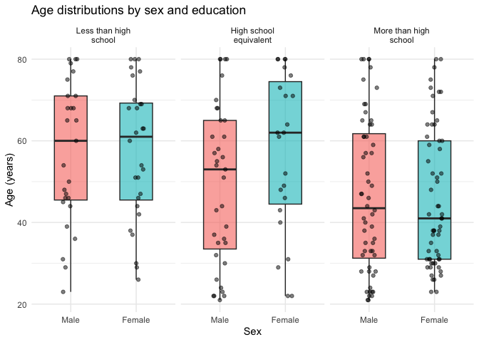
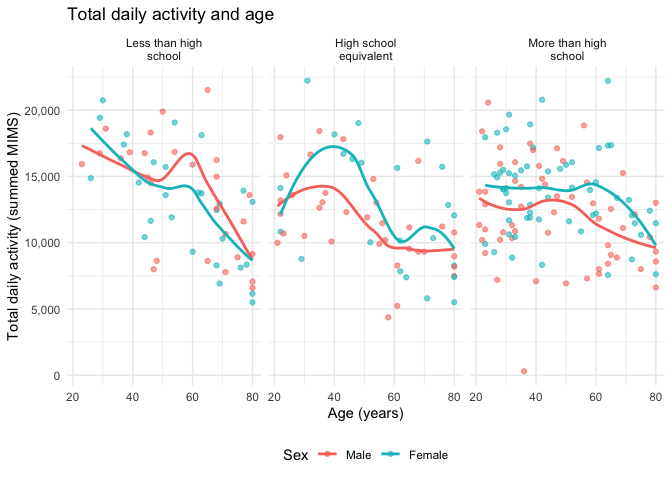
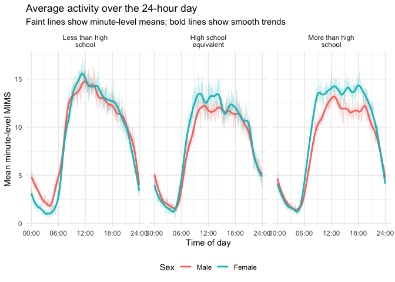
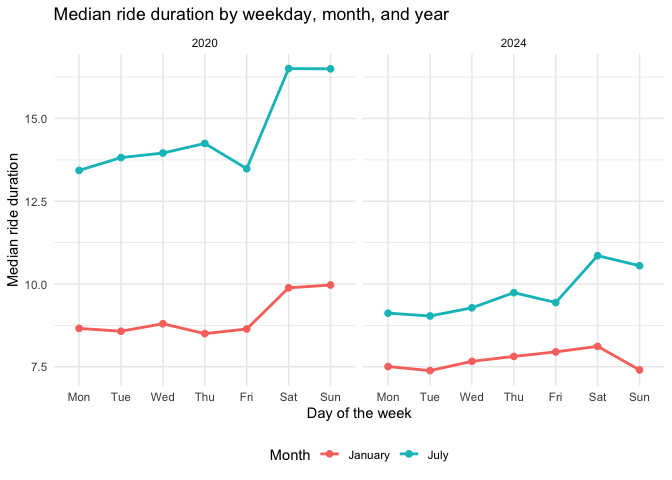

P8105_HW3
================
Qiaoen Xia
2026-10-19

\#Q2

``` r
library(readr)
library(tidyverse)
```

    ## ── Attaching core tidyverse packages ──────────────────────── tidyverse 2.0.0 ──
    ## ✔ dplyr     1.2.1     ✔ purrr     1.2.2
    ## ✔ forcats   1.0.1     ✔ stringr   1.6.0
    ## ✔ ggplot2   4.0.3     ✔ tibble    3.3.1
    ## ✔ lubridate 1.9.5     ✔ tidyr     1.3.2
    ## ── Conflicts ────────────────────────────────────────── tidyverse_conflicts() ──
    ## ✖ dplyr::filter() masks stats::filter()
    ## ✖ dplyr::lag()    masks stats::lag()
    ## ℹ Use the conflicted package (<http://conflicted.r-lib.org/>) to force all conflicts to become errors

``` r
nhanes_covar = read_csv(
  "data/nhanes_covar.csv",
  skip = 4,
  show_col_types = FALSE
) |>
  rename(
    id = SEQN,
    bmi = BMI
  ) |>
  drop_na(sex, age, bmi, education) |>
  filter(age >= 21) |>
  mutate(
    sex = factor(
      sex,
      levels = c(1, 2),
      labels = c("Male", "Female")
    ),
    education = factor(
      education,
      levels = c(1, 2, 3),
      labels = c(
        "Less than high school",
        "High school equivalent",
        "More than high school"
      )
    )
  )


nhanes_accel = read_csv(
  "data/nhanes_accel.csv",
  show_col_types = FALSE
) |>
  rename(id = SEQN)
```

``` r
nhanes_joint_tidy = nhanes_covar |>
  inner_join(nhanes_accel, by = "id")
```

``` r
nhanes_joint_tidy |>
  count(education, sex) |>
  pivot_wider(
    names_from = sex,
    values_from = n
  ) |>
  knitr::kable(
    col.names = c("Education level", "Men", "Women"),
    caption = "Number of participants by education level and sex"
  )
```

| Education level        | Men | Women |
|:-----------------------|----:|------:|
| Less than high school  |  27 |    28 |
| High school equivalent |  35 |    23 |
| More than high school  |  56 |    59 |

Number of participants by education level and sex

``` r
# Age distributions by sex and education
age_plot = nhanes_joint_tidy |>
  ggplot(aes(x = sex, y = age, fill = sex)) +
  geom_boxplot(
    width = 0.5,
    alpha = 0.6,
    outlier.shape = NA
  ) +
  geom_jitter(
    width = 0.12,
    height = 0,
    alpha = 0.5,
    size = 1.5
  ) +
  facet_wrap(
    ~ education,
    nrow = 1,
    labeller = label_wrap_gen(width = 20)
  ) +
  labs(
    title = "Age distributions by sex and education",
    x = "Sex",
    y = "Age (years)"
  ) +
  theme_minimal() +
  theme(legend.position = "none")

age_plot
```

<!-- --> The
sample includes 228 participants. The more than high school category is
the largest, with 56 men and 59 women. The less than high school
category has nearly equal numbers of men and women (27 and 28), while
the high school equivalent category includes more men than women (35
versus 23). Participants with more than a high school education tend to
be younger, with median ages in the early 40s for both sexes. In the
less than high school category, median ages are approximately 60 for
both sexes. In the high school equivalent category, women tend to be
older than men, with median ages of approximately 62 and 53,
respectively.

``` r
#Total daily activity for each participant 
nhanes_total = nhanes_joint_tidy |>
  mutate(
    total_activity = rowSums(pick(starts_with("min")))
  )

total_activity_plot = nhanes_total |>
  ggplot(aes(x = age, y = total_activity, color = sex)) +
  geom_point(alpha = 0.6) +
  geom_smooth(
    method = "loess",
    formula = y ~ x,
    se = FALSE
  ) +
  facet_wrap(
    ~ education,
    nrow = 1,
    labeller = label_wrap_gen(width = 20)
  ) +
  scale_y_continuous(labels = scales::label_comma()) +
  labs(
    title = "Total daily activity and age",
    x = "Age (years)",
    y = "Total daily activity (summed MIMS)",
    color = "Sex"
  ) +
  theme_minimal() +
  theme(legend.position = "bottom")

total_activity_plot
```

<!-- -->
Total daily activity generally decreases with age across all education
categories, although the smooth curves show nonlinear patterns. The
decline is particularly clear in the less than high school category. In
the high school equivalent category, activity peaks around ages 35–40
before declining, with women generally showing higher activity than men
through much of middle age. Among participants with more than a high
school education, women generally have higher activity than men until
the curves converge near age 80. Considerable variation exists among
participants of similar ages, and sex differences are less consistent in
the less than high school category.

``` r
nhanes_long = nhanes_joint_tidy |>
  pivot_longer(
    cols = starts_with("min"),
    names_to = "minute",
    names_prefix = "min",
    names_transform = list(minute = as.integer),
    values_to = "mims"
  ) |>
  mutate(
    hour = (minute - 1) / 60
  )
```

``` r
#Mean activity at each minute by education and sex

nhanes_timecourse = nhanes_long |>
  group_by(education, sex, minute, hour) |>
  summarize(
    mean_mims = mean(mims),
    .groups = "drop"
  )
```

``` r
#Activity over the 24-hour day 

timecourse_plot = nhanes_timecourse |>
  ggplot(aes(x = hour, y = mean_mims, color = sex)) +
  geom_line(
    alpha = 0.25,
    linewidth = 0.3
  ) +
  geom_smooth(
    method = "loess",
    formula = y ~ x,
    span = 0.15,
    se = FALSE,
    linewidth = 1
  ) +
  facet_wrap(
    ~ education,
    nrow = 1,
    labeller = label_wrap_gen(width = 20)
  ) +
  scale_x_continuous(
    breaks = c(0, 6, 12, 18, 24),
    labels = c("00:00", "06:00", "12:00", "18:00", "24:00"),
    limits = c(0, 24)
  ) +
  labs(
    title = "Average activity over the 24-hour day",
    subtitle = "Faint lines show minute-level means; bold lines show smooth trends",
    x = "Time of day",
    y = "Mean minute-level MIMS",
    color = "Sex"
  ) +
  theme_minimal() +
  theme(legend.position = "bottom")

timecourse_plot
```

<!-- -->

All three education categories show a similar daily pattern: activity is
lowest in the early morning, rises sharply around 06:00, remains
elevated during the day, and declines in the evening. Participants with
less than a high school education show a pronounced late-morning peak,
with similar daytime activity between sexes but higher overnight
activity among men. In the high school equivalent category, women
generally show slightly higher activity during the late morning and
early afternoon. The clearest daytime sex difference appears in the more
than high school category, where women maintain higher activity through
most of the day, particularly into the early evening. These descriptive
differences may partly reflect differences in age composition across
groups.

\#Q3

``` r
Jan_2020_Citi <- read_csv("data/Jan 2020 Citi.csv")
```

    ## Rows: 12420 Columns: 7
    ## ── Column specification ────────────────────────────────────────────────────────
    ## Delimiter: ","
    ## chr (6): ride_id, rideable_type, weekdays, start_station_name, end_station_n...
    ## dbl (1): duration
    ## 
    ## ℹ Use `spec()` to retrieve the full column specification for this data.
    ## ℹ Specify the column types or set `show_col_types = FALSE` to quiet this message.

``` r
Jan_2024_Citi <- read_csv("data/Jan 2024 Citi.csv")
```

    ## Rows: 18861 Columns: 7
    ## ── Column specification ────────────────────────────────────────────────────────
    ## Delimiter: ","
    ## chr (6): ride_id, rideable_type, weekdays, start_station_name, end_station_n...
    ## dbl (1): duration
    ## 
    ## ℹ Use `spec()` to retrieve the full column specification for this data.
    ## ℹ Specify the column types or set `show_col_types = FALSE` to quiet this message.

``` r
July_2020_Citi <- read_csv("data/July 2020 Citi.csv")
```

    ## Rows: 21048 Columns: 7
    ## ── Column specification ────────────────────────────────────────────────────────
    ## Delimiter: ","
    ## chr (6): ride_id, rideable_type, weekdays, start_station_name, end_station_n...
    ## dbl (1): duration
    ## 
    ## ℹ Use `spec()` to retrieve the full column specification for this data.
    ## ℹ Specify the column types or set `show_col_types = FALSE` to quiet this message.

``` r
July_2024_Citi <- read_csv("data/July 2024 Citi.csv")
```

    ## Rows: 47156 Columns: 7
    ## ── Column specification ────────────────────────────────────────────────────────
    ## Delimiter: ","
    ## chr (6): ride_id, rideable_type, weekdays, start_station_name, end_station_n...
    ## dbl (1): duration
    ## 
    ## ℹ Use `spec()` to retrieve the full column specification for this data.
    ## ℹ Specify the column types or set `show_col_types = FALSE` to quiet this message.

``` r
citibike_tidy = bind_rows(
  "2020_January" = Jan_2020_Citi,
  "2024_January" = Jan_2024_Citi,
  "2020_July" = July_2020_Citi,
  "2024_July" = July_2024_Citi,
  .id = "source"
) |>
  separate(
    source,
    into = c("year", "month"),
    sep = "_"
  ) |>
  mutate(
    year = factor(
      year,
      levels = c("2020", "2024")
    ),
    month = factor(
      month,
      levels = c("January", "July")
    ),
    weekdays = str_to_title(str_trim(weekdays)),
    weekdays = factor(
      weekdays,
      levels = c(
        "Monday", "Tuesday", "Wednesday",
        "Thursday", "Friday", "Saturday", "Sunday"
      )
    ),
    member_casual = factor(
      str_to_lower(str_trim(member_casual)),
      levels = c("casual", "member"),
      labels = c("Casual", "Member")
    ),
    rideable_type = factor(
      str_to_lower(str_trim(rideable_type))
    ),
    across(
      c(start_station_name, end_station_name),
      ~ na_if(str_trim(.x), "")
    )
  )

glimpse(citibike_tidy)
```

    ## Rows: 99,485
    ## Columns: 9
    ## $ year               <fct> 2020, 2020, 2020, 2020, 2020, 2020, 2020, 2020, 202…
    ## $ month              <fct> January, January, January, January, January, Januar…
    ## $ ride_id            <chr> "4BE06CB33B037044", "26886E034974493B", "24DC56060E…
    ## $ rideable_type      <fct> classic_bike, classic_bike, classic_bike, classic_b…
    ## $ weekdays           <fct> Tuesday, Wednesday, Friday, Sunday, Friday, Sunday,…
    ## $ duration           <dbl> 15.333267, 5.309467, 9.691800, 6.996183, 2.849500, …
    ## $ start_station_name <chr> "Columbus Ave & W 95 St", "2 Ave & E 96 St", "Colum…
    ## $ end_station_name   <chr> "E 53 St & Madison Ave", "1 Ave & E 110 St", "Grand…
    ## $ member_casual      <fct> Member, Member, Member, Member, Member, Member, Mem…

``` r
citibike_summary = citibike_tidy |>
  summarize(
    n_rides = n(),
    n_variables = ncol(citibike_tidy),
    n_unique_ride_ids = n_distinct(ride_id),
    missing_start_station = sum(is.na(start_station_name)),
    missing_end_station = sum(is.na(end_station_name)),
    missing_duration = sum(is.na(duration)),
    missing_weekday = sum(is.na(weekdays)),
    missing_membership = sum(is.na(member_casual))
  )

citibike_summary |>
  knitr::kable(
    caption = "Summary of the combined Citi Bike dataset"
  )
```

| n_rides | n_variables | n_unique_ride_ids | missing_start_station | missing_end_station | missing_duration | missing_weekday | missing_membership |
|---:|---:|---:|---:|---:|---:|---:|---:|
| 99485 | 9 | 99485 | 43 | 207 | 0 | 0 | 0 |

Summary of the combined Citi Bike dataset

``` r
citibike_tidy |>
  count(rideable_type)
```

    ## # A tibble: 2 × 2
    ##   rideable_type     n
    ##   <fct>         <int>
    ## 1 classic_bike  55536
    ## 2 electric_bike 43949

``` r
summary(citibike_tidy$duration)
```

    ##    Min. 1st Qu.  Median    Mean 3rd Qu.    Max. 
    ##   1.002   5.595   9.839  13.930  17.560 238.780

The cleaned dataset contains 99,485 rides and 9 variables, combining
January and July data from 2020 and 2024. Each row represents a unique
ride and includes its ID, bike type, weekday, duration, starting and
ending stations, membership status, year, and month. There are 55,536
classic bike rides and 43,949 electric bike rides. Starting station
names are missing for 43 rides, and ending station names are missing for
207 rides; these records are retained for analyses that do not require
station information. Ride duration, weekday, and membership status have
no missing values. Ride durations are right-skewed, with a median of
9.84 and a mean of 13.93, ranging from approximately 1.00 to 238.78.

``` r
ride_count_table = citibike_tidy |>
  count(year, month, member_casual, name = "n_rides") |>
  pivot_wider(
    names_from = member_casual,
    values_from = n_rides,
    values_fill = 0
  ) |>
  mutate(
    Total = Casual + Member
  ) |>
  arrange(year, month)

ride_count_table |>
  knitr::kable(
    col.names = c("Year", "Month", "Casual", "Member", "Total"),
    format.args = list(big.mark = ","),
    caption = "Number of sampled rides by year, month, and membership"
  )
```

| Year | Month   | Casual | Member |  Total |
|:-----|:--------|-------:|-------:|-------:|
| 2020 | January |    984 | 11,436 | 12,420 |
| 2020 | July    |  5,637 | 15,411 | 21,048 |
| 2024 | January |  2,108 | 16,753 | 18,861 |
| 2024 | July    | 10,894 | 36,262 | 47,156 |

Number of sampled rides by year, month, and membership

Members account for most sampled rides in every year–month combination.
July has more rides than January in both years, and both casual and
member ride counts are higher in 2024 than in the corresponding months
of 2020. July 2024 has the largest total, with 47,156 rides, compared
with 21,048 in July 2020. Casual riders also represent a larger share of
rides in July than in January: approximately 27% versus 8% in 2020 and
23% versus 11% in 2024. These results suggest seasonal differences in
ridership and increased system use between the two years.

``` r
top_start_stations = citibike_tidy |>
  filter(
    year == "2024",
    month == "July",
    !is.na(start_station_name)
  ) |>
  count(start_station_name, name = "n_rides") |>
  arrange(desc(n_rides), start_station_name) |>
  slice_head(n = 5)

top_start_stations |>
  knitr::kable(
    col.names = c("Starting station", "Number of rides"),
    format.args = list(big.mark = ","),
    caption = "Five most popular starting stations in July 2024"
  )
```

| Starting station         | Number of rides |
|:-------------------------|----------------:|
| Pier 61 at Chelsea Piers |             163 |
| University Pl & E 14 St  |             155 |
| W 21 St & 6 Ave          |             152 |
| West St & Chambers St    |             150 |
| W 31 St & 7 Ave          |             146 |

Five most popular starting stations in July 2024

``` r
median_duration = citibike_tidy |>
  group_by(year, month, weekdays) |>
  summarize(
    median_duration = median(duration, na.rm = TRUE),
    .groups = "drop"
  )

median_duration_plot = median_duration |>
  ggplot(
    aes(
      x = weekdays,
      y = median_duration,
      color = month,
      group = month
    )
  ) +
  geom_line(linewidth = 1) +
  geom_point(size = 2) +
  facet_wrap(~ year, nrow = 1) +
  scale_x_discrete(
    labels = c("Mon", "Tue", "Wed", "Thu", "Fri", "Sat", "Sun")
  ) +
  labs(
    title = "Median ride duration by weekday, month, and year",
    x = "Day of the week",
    y = "Median ride duration",
    color = "Month"
  ) +
  theme_minimal() +
  theme(legend.position = "bottom")

median_duration_plot
```

<!-- -->
Median ride duration is higher in July than in January on every day of
the week in both years. Durations are also consistently lower in 2024
than in 2020, with a particularly large decrease in July. In July 2020,
median duration rises from approximately 13–14 on weekdays to 16.5 on
weekends, compared with approximately 9–10 and 10.5–11, respectively, in
July 2024. Weekend increases are also evident in January 2020, whereas
January 2024 shows relatively little variation across the week and a
decrease on Sunday. Overall, the July–January difference and the weekend
increase are more pronounced in 2020.

``` r
citibike_tidy |>
  filter(year == "2024") |>
  group_by(month, member_casual, rideable_type) |>
  summarize(
    n_rides = n(),
    median_duration = median(duration, na.rm = TRUE),
    q1 = quantile(duration, 0.25, na.rm = TRUE),
    q3 = quantile(duration, 0.75, na.rm = TRUE),
    .groups = "drop"
  ) |>
  knitr::kable(
    digits = 2,
    caption = "Ride duration summaries in 2024"
  )
```

| month   | member_casual | rideable_type | n_rides | median_duration |   q1 |    q3 |
|:--------|:--------------|:--------------|--------:|----------------:|-----:|------:|
| January | Casual        | classic_bike  |     456 |           12.69 | 7.05 | 24.00 |
| January | Casual        | electric_bike |    1652 |            9.34 | 5.56 | 16.15 |
| January | Member        | classic_bike  |    6252 |            7.32 | 4.24 | 12.76 |
| January | Member        | electric_bike |   10501 |            7.58 | 4.65 | 12.41 |
| July    | Casual        | classic_bike  |    3133 |           15.62 | 9.01 | 25.51 |
| July    | Casual        | electric_bike |    7761 |           12.94 | 7.56 | 22.16 |
| July    | Member        | classic_bike  |   13165 |            7.68 | 4.36 | 13.69 |
| July    | Member        | electric_bike |   23097 |            9.24 | 5.42 | 15.52 |

Ride duration summaries in 2024

In 2024, casual riders have longer median ride durations and wider
interquartile ranges than members within each month and bike type.
Median durations are higher in July than in January across all groups.
Among casual riders, classic bike rides last longer than electric bike
rides, with medians of 15.62 versus 12.94 in July. Among members,
electric bike rides have slightly higher medians than classic bike
rides, particularly in July (9.24 versus 7.68). Casual classic bike
rides show the greatest variability in both months. Overall, differences
by membership status are more pronounced than differences by bike type.
